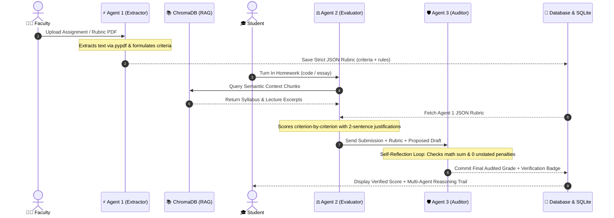

# 🎓 Autonomous Agentic AI Google Classroom & Multi-Agent Assessment System

An advanced academic operating system that pairs a Google Classroom interface with a production-grade **Multi-Agent Evaluation Pipeline**. Powered by **Groq Cloud LLM (`qwen/qwen3.8-27b`)**, **ChromaDB vector retrieval**, and a dual-database persistence engine (**JSON + SQLite ORM**).

Instead of relying on a single prompt, this system implements an autonomous, self-reflecting multi-agent workflow where specialized AI agents collaborate, exchange structured data contracts, and audit their own evaluations before persisting grades.

---

## 📑 Table of Contents
- [🧠 What Makes This System Truly "Agentic AI"?](#-what-makes-this-system-truly-agentic-ai)
- [🤖 The Core Multi-Agent Evaluation Pipeline](#-the-core-multi-agent-evaluation-pipeline)
  - [1. Agent 1: The Extractor Agent (Academic Curriculum Designer)](#1-agent-1-the-extractor-agent-academic-curriculum-designer)
  - [2. Agent 2: The Evaluator Agent (Impartial Academic Grader)](#2-agent-2-the-evaluator-agent-impartial-academic-grader)
  - [3. Agent 3: The Auditor Agent (Senior Academic Auditor & Self-Reflection Loop)](#3-agent-3-the-auditor-agent-senior-academic-auditor--self-reflection-loop)
- [🤖 Additional Specialized Agents in the Ecosystem](#-additional-specialized-agents-in-the-ecosystem)
  - [JARVIS AI Classroom Assistant & Grounded Tutor Agent](#jarvis-ai-classroom-assistant--grounded-tutor-agent)
  - [Adaptive Quiz Generation Agent](#adaptive-quiz-generation-agent)
  - [Pedagogical Grace Marks & Teacher Feedback Agent](#pedagogical-grace-marks--teacher-feedback-agent)
  - [Dynamic Course Credit & Customizable Evaluation Scheme Agent](#dynamic-course-credit--customizable-evaluation-scheme-agent)
  - [Analytics & Mastery Profiling Agent](#analytics--mastery-profiling-agent)
- [🗺️ Multi-Agent Interaction Flowchart](#️-multi-agent-interaction-flowchart)
- [📁 Comprehensive Codebase File Map](#-comprehensive-codebase-file-map)
- [🔌 API Endpoints & Request Contracts](#-api-endpoints--request-contracts)
- [🚀 Quick Start & Launch Guide](#-quick-start--launch-guide)

---

## 🧠 What Makes This System Truly "Agentic AI"?

Traditional AI grading attempts to grade student work by dumping unformatted prompt text into a single LLM request. This causes hallucinations, arithmetic errors, scoring drift, and unstated criteria penalties.

This system replaces that flawed pattern with an **Autonomous Multi-Agent Architecture**:
1. **Separation of Concerns**: Each step of the grading lifecycle is delegated to an autonomous agent with a narrow, rigorous persona and strict output schema.
2. **Autonomous Curriculum Extraction**: Faculty don't have to manually key in rubrics. Uploading an assignment or rubric document (PDF, Word, Markdown, or text) triggers the **Extractor Agent**, which parses the file via [`pypdf`](file:///c:/agentic%20AI%20project/agents/multi_agent_pipeline.py#L25) and mathematically formulates criteria, max points, and earning rules.
3. **ChromaDB Semantic Grounding (RAG)**: The **Evaluator Agent** performs vector similarity search across course materials, lecture notes, and official syllabus milestones in [`rag/knowledge_base.py`](file:///c:/agentic%20AI%20project/rag/knowledge_base.py) before scoring.
4. **Agentic Self-Reflection Loop**: Before any grade is committed to the database, the **Auditor Agent** independently verifies the arithmetic sum of the criteria scores, confirms that zero deductions were applied for rules not in the rubric, and issues an `APPROVED` or `CORRECTED` verdict.

---

## 🤖 The Core Multi-Agent Evaluation Pipeline

The evaluation pipeline is orchestrated between [`agents/multi_agent_pipeline.py`](file:///c:/agentic%20AI%20project/agents/multi_agent_pipeline.py), [`server.py`](file:///c:/agentic%20AI%20project/server.py), and the Next.js API [`frontend/app/api/submissions/route.ts`](file:///c:/agentic%20AI%20project/frontend/app/api/submissions/route.ts).

```
Faculty Uploads Rubric / Assignment PDF
                │
                ▼
   [ AGENT 1: EXTRACTOR AGENT ]
  (Academic Curriculum Designer)
  • Extracts text via pypdf
  • Formulates JSON rubric with criteria, maxPoints & strict rules
                │
                ▼
   Strict JSON Rubric Saved to DB
                │
┌───────────────┴───────────────────────────────┐
│ Student Submits Work (solution.py / essay.md) │
└───────────────┬───────────────────────────────┘
                │
                ▼
   [ ChromaDB RAG Vector Grounding ]
   • Fetches syllabus & lecture note embeddings
                │
                ▼
   [ AGENT 2: EVALUATOR AGENT ]
  (Impartial Academic Grader)
  • Evaluates step-by-step through JSON rubric
  • Awards point-by-point scores with 2-sentence justifications
  • Recommends good-faith grace marks
                │
                ▼
   Proposed Score Breakdown & Draft
                │
                ▼
   [ AGENT 3: AUDITOR AGENT ]
  (Senior Academic Auditor - Self-Reflection Loop)
  • Audits arithmetic sum: criteria sum == proposed total
  • Verifies compliance: 0 unstated deduction rules
  • Reflection Verdict: APPROVED ✓ or CORRECTED ✓
                │
                ▼
   Persisted to Database & SQLite
  (With Full Multi-Agent Reflection Trail)
```

---

### 1. Agent 1: The Extractor Agent (Academic Curriculum Designer)

Runs when a professor creates an assignment or attaches an assignment specification / rubric PDF.

- **Primary Code File**: [`agents/multi_agent_pipeline.py`](file:///c:/agentic%20AI%20project/agents/multi_agent_pipeline.py#L90-L198)
- **FastAPI Endpoint**: [`POST /api/agents/extract-rubric`](file:///c:/agentic%20AI%20project/server.py#L398)
- **Frontend Route**: [`frontend/app/api/ai/rubric/route.ts`](file:///c:/agentic%20AI%20project/frontend/app/api/ai/rubric/route.ts)
- **Frontend UI Component**: [`frontend/components/classroom/ClassworkTab.tsx`](file:///c:/agentic%20AI%20project/frontend/components/classroom/ClassworkTab.tsx#L1789)
- **Execution Role**: Academic Curriculum Designer.
- **Core Directive**:
  > *"You are an academic curriculum designer. Read this assignment document and extract the exact grading criteria. Output a strict JSON object containing an array of criteria, the maximum points for each, and the specific rules for earning those points."*
- **Capabilities**:
  - Automatically parses binary PDF streams using `pypdf.PdfReader` ([`agents/multi_agent_pipeline.py`](file:///c:/agentic%20AI%20project/agents/multi_agent_pipeline.py#L25)).
  - Distinguishes between theoretical essays (thesis clarity, analytical depth, comparative arguments) and coding implementations (algorithmic logic, defensive edge-case handling, complexity bounds).
  - Normalizes criteria points so they strictly sum up to the target assignment points (e.g. 100 points).
  - Generates an encouraging teacher grace marks guideline (+2 to +6 marks for sincere effort).
- **Output JSON Contract**:
  ```json
  {
    "assignmentTitle": "Dynamic Programming & Matrix Exponentiation",
    "totalPoints": 100,
    "criteria": [
      {
        "id": "crit_1",
        "name": "Algorithmic Correctness & Logic",
        "maxPoints": 40,
        "rules": "Full points require a working implementation computing the Nth Fibonacci number in O(log n). Partial points for handling base cases."
      },
      {
        "id": "crit_2",
        "name": "Boundary & Defensive Handling",
        "maxPoints": 30,
        "rules": "Handles n=0, negative values, and large inputs without overflow."
      },
      {
        "id": "crit_3",
        "name": "Code Architecture & Complexity",
        "maxPoints": 30,
        "rules": "Adheres to O(log n) time and O(1) auxiliary space."
      }
    ],
    "graceMarksPolicy": {
      "maxGrace": 5,
      "guideline": "Award +2 to +5 marks for clean docstrings and defensive validations."
    }
  }
  ```

---

### 2. Agent 2: The Evaluator Agent (Impartial Academic Grader)

Kicks off the grading loop when a student turns in their work.

- **Primary Code File**: [`agents/multi_agent_pipeline.py`](file:///c:/agentic%20AI%20project/agents/multi_agent_pipeline.py#L204-L318)
- **FastAPI Endpoint**: [`POST /api/agents/evaluate`](file:///c:/agentic%20AI%20project/server.py#L433)
- **Frontend Route**: [`frontend/app/api/submissions/route.ts`](file:///c:/agentic%20AI%20project/frontend/app/api/submissions/route.ts#L130)
- **RAG Grounding**: [`rag/knowledge_base.py`](file:///c:/agentic%20AI%20project/rag/knowledge_base.py#L123)
- **Execution Role**: Impartial Academic Grader.
- **Core Directive**:
  > *"You are an impartial academic grader. Here is the student's submission. Here is the strict JSON grading rubric. Go step-by-step through each criterion in the JSON. Assign a score for each, and write a 2-sentence justification for why you gave that score based on the rubric."*
- **Capabilities**:
  - Grounds evaluation in ChromaDB vector chunks and classroom lecture notes.
  - Grades criterion-by-criterion strictly within the `maxPoints` defined by Agent 1.
  - Writes a concise 2-sentence justification for every criterion explaining what was earned and what was missed.
  - Proposes generous partial credit and teacher grace marks for intellectual effort.
- **Output JSON Contract**:
  ```json
  {
    "criteriaEvaluations": [
      {
        "criterionId": "crit_1",
        "name": "Algorithmic Correctness & Logic",
        "maxPoints": 40,
        "scoreAwarded": 36,
        "justification": "The matrix exponentiation correctly calculates the Fibonacci sequence in logarithmic time. However, the helper multiplication function omits validation for empty matrices."
      }
    ],
    "proposedCriteriaSum": 86,
    "proposedGraceMarks": 4,
    "graceMarksReason": "Awarded +4 grace marks for clean functional decomposition and clear comments.",
    "proposedTotalScore": 90,
    "masteryLevel": "advanced"
  }
  ```

---

### 3. Agent 3: The Auditor Agent (Senior Academic Auditor & Self-Reflection Loop)

The self-reflection loop that ensures reliability before any score is saved.

- **Primary Code File**: [`agents/multi_agent_pipeline.py`](file:///c:/agentic%20AI%20project/agents/multi_agent_pipeline.py#L324-L465)
- **FastAPI Endpoint**: [`POST /api/agents/audit`](file:///c:/agentic%20AI%20project/server.py#L450)
- **Orchestrator Endpoint**: [`POST /api/agents/pipeline`](file:///c:/agentic%20AI%20project/server.py#L466)
- **Frontend UI View (Student)**: [`frontend/components/classroom/ClassworkTab.tsx`](file:///c:/agentic%20AI%20project/frontend/components/classroom/ClassworkTab.tsx#L1250-L1390)
- **Frontend UI View (Faculty)**: [`frontend/components/classroom/ClassworkTab.tsx`](file:///c:/agentic%20AI%20project/frontend/components/classroom/ClassworkTab.tsx#L2085-L2210)
- **Frontend Gradebook View**: [`frontend/components/classroom/GradesTab.tsx`](file:///c:/agentic%20AI%20project/frontend/components/classroom/GradesTab.tsx#L629-L735)
- **Execution Role**: Senior Academic Auditor.
- **Core Directive**:
  > *"You are a senior academic auditor. Review this proposed grading. Check the math to ensure the total score is correct. Verify that no points were deducted for rules that are not explicitly stated in the JSON Rubric. If the grading is fair, output 'APPROVED' and the final JSON. If it is flawed, correct the score and explain the correction."*
- **Capabilities**:
  - **Arithmetic Verification**: Independently calculates $\sum (\text{criterion score}) + \text{grace marks} = \text{total score}$.
  - **Rubric Compliance Audit**: Scrutinizes Agent 2's justifications to ensure no penalties were levied for unstated criteria or subjective formatting preferences.
  - **Verdict Output**: Flags evaluations as `APPROVED` or `CORRECTED`.
  - **Verification Badge**: Issues the verifiable cryptographic badge: `Audited & Verified by Senior Academic AI Auditor: APPROVED ✓`.
- **Output JSON Contract**:
  ```json
  {
    "auditStatus": "APPROVED",
    "reflectionVerdict": "APPROVED",
    "mathCheck": {
      "calculatedCriteriaSum": 86,
      "proposedTotal": 90,
      "isValid": true,
      "notes": "Criteria sum (86) + grace marks (4) mathematically equals 90."
    },
    "rubricCompliance": {
      "isStrictlyCompliant": true,
      "unauthorizedDeductionsFound": false,
      "notes": "Verified that all deductions strictly reflect rules declared in Agent 1 rubric."
    },
    "auditExplanation": "Senior Academic Auditor verified arithmetic summation and confirmed 100% adherence to rubric guidelines.",
    "finalOverallScore": 90,
    "finalPercentage": 90,
    "verificationBadge": "Audited & Verified by Senior Academic AI Auditor: APPROVED ✓"
  }
  ```

---

## 🤖 Additional Specialized Agents in the Ecosystem

Beyond the 3-agent grading pipeline, the system includes multiple specialized agents:

### JARVIS AI Classroom Assistant & Grounded Tutor Agent
- **File**: [`frontend/app/api/ai/jarvis/route.ts`](file:///c:/agentic%20AI%20project/frontend/app/api/ai/jarvis/route.ts)
- **UI Trigger**: Left navigation drawer & Top Navigation Bar ([`frontend/components/layout/Navbar.tsx`](file:///c:/agentic%20AI%20project/frontend/components/layout/Navbar.tsx#L70))
- **Functionality**:
  - Grounded directly in live classroom state, syllabus milestone status, upcoming deadlines, and user enrollment.
  - Enforces strict student enrollment boundaries: students only see information regarding classes they are actively enrolled in.
  - Provides customized tutoring, syllabus milestone explanations, and assignment clarification.

### Adaptive Quiz Generation Agent
- **File**: [`frontend/app/api/ai/quiz/route.ts`](file:///c:/agentic%20AI%20project/frontend/app/api/ai/quiz/route.ts)
- **UI Modal**: [`frontend/components/classroom/QuizModal.tsx`](file:///c:/agentic%20AI%20project/frontend/components/classroom/QuizModal.tsx)
- **Functionality**:
  - Dynamically synthesizes timed multiple-choice assessments tailored to the course's completed syllabus modules.
  - Formulates distractors, correct answers, and thorough pedagogical explanations for each option.

### Pedagogical Grace Marks & Teacher Feedback Agent
- **File**: [`agents/feedback_agent.py`](file:///c:/agentic%20AI%20project/agents/feedback_agent.py) & [`server.py`](file:///c:/agentic%20AI%20project/server.py#L240)
- **Functionality**:
  - Evaluates good-faith student efforts, structural clarity, and problem-solving intuition.
  - Awards between +2 and +6 teacher grace marks accompanied by warm, encouraging academic mentorship notes.

### Dynamic Course Credit & Customizable Evaluation Scheme Agent
- **File**: [`frontend/lib/evaluation.ts`](file:///c:/agentic%20AI%20project/frontend/lib/evaluation.ts) & [`frontend/components/classroom/GradesTab.tsx`](file:///c:/agentic%20AI%20project/frontend/components/classroom/GradesTab.tsx#L665)
- **Functionality**:
  - Supports configurable course grading breakdowns (e.g., End Term Exam 40%, Mid Term 30%, Quizzes 15%, Practical Labs 15%).
  - Automatically matches assignments to appropriate evaluation components and computes weighted cumulative grades in real-time.

### Analytics & Mastery Profiling Agent
- **File**: [`agents/analytics_agent.py`](file:///c:/agentic%20AI%20project/agents/analytics_agent.py)
- **Functionality**:
  - Computes class-wide performance metrics, topic-wise mastery distributions, and identifies students needing targeted interventions.

---

## 🗺️ Multi-Agent Interaction Flowchart



---

## 📁 Comprehensive Codebase File Map

### 1. Python Multi-Agent Backend & Vector Storage
| Component | File Path | Description |
| :--- | :--- | :--- |
| **Multi-Agent Pipeline** | [`agents/multi_agent_pipeline.py`](file:///c:/agentic%20AI%20project/agents/multi_agent_pipeline.py) | Contains `ExtractorAgent`, `EvaluatorAgent`, `AuditorAgent`, `MultiAgentPipeline`, and `pypdf` text extractors. |
| **Agent Registry** | [`agents/__init__.py`](file:///c:/agentic%20AI%20project/agents/__init__.py) | Exports all core assessment and evaluation agents. |
| **FastAPI Backend Server** | [`server.py`](file:///c:/agentic%20AI%20project/server.py) | Exposes multi-agent REST endpoints, sync endpoints, and Groq API calls on port `8000`. |
| **ChromaDB RAG Knowledge Base** | [`rag/knowledge_base.py`](file:///c:/agentic%20AI%20project/rag/knowledge_base.py) | Manages vector embeddings and similarity queries for course syllabus and lecture materials. |
| **SQLite Database ORM** | [`database.py`](file:///c:/agentic%20AI%20project/database.py) | SQLAlchemy database models (`User`, `Course`, `Assignment`, `Submission`, `Evaluation`). |
| **Heuristic Analytics Agent** | [`agents/analytics_agent.py`](file:///c:/agentic%20AI%20project/agents/analytics_agent.py) | Class mastery distributions and student risk profiling. |
| **Feedback Synthesis Agent** | [`agents/feedback_agent.py`](file:///c:/agentic%20AI%20project/agents/feedback_agent.py) | Pedagogical student feedback formatting. |

### 2. Next.js Frontend & API Routes
| Component | File Path | Description |
| :--- | :--- | :--- |
| **Extractor Rubric API** | [`frontend/app/api/ai/rubric/route.ts`](file:///c:/agentic%20AI%20project/frontend/app/api/ai/rubric/route.ts) | Next.js endpoint invoking the Extractor Agent pipeline. |
| **Submissions & Multi-Agent API** | [`frontend/app/api/submissions/route.ts`](file:///c:/agentic%20AI%20project/frontend/app/api/submissions/route.ts) | Executes RAG + Evaluator Agent + Auditor Agent grading pipeline. |
| **JARVIS AI Chatbot API** | [`frontend/app/api/ai/jarvis/route.ts`](file:///c:/agentic%20AI%20project/frontend/app/api/ai/jarvis/route.ts) | Context-aware classroom assistant with strict enrolled class grounding. |
| **Adaptive Quiz API** | [`frontend/app/api/ai/quiz/route.ts`](file:///c:/agentic%20AI%20project/frontend/app/api/ai/quiz/route.ts) | Dynamic quiz synthesis grounded in current syllabus milestones. |
| **Classes & Custom Scheme API** | [`frontend/app/api/classes/route.ts`](file:///c:/agentic%20AI%20project/frontend/app/api/classes/route.ts) | Class management and credit evaluation scheme customization. |
| **JSON Database Client** | [`frontend/lib/db.ts`](file:///c:/agentic%20AI%20project/frontend/lib/db.ts) | Local JSON persistence engine with file storage handlers. |
| **Course Evaluation Library** | [`frontend/lib/evaluation.ts`](file:///c:/agentic%20AI%20project/frontend/lib/evaluation.ts) | Weighted average computation and scheme configuration models. |

### 3. Frontend UI Components
| Component | File Path | Description |
| :--- | :--- | :--- |
| **Classwork Tab & Submissions** | [`frontend/components/classroom/ClassworkTab.tsx`](file:///c:/agentic%20AI%20project/frontend/components/classroom/ClassworkTab.tsx) | Student turn-in, Extractor Agent upload modal, Auditor verification badge, and 3-agent trail accordion. |
| **Gradebook & Scheme Editor** | [`frontend/components/classroom/GradesTab.tsx`](file:///c:/agentic%20AI%20project/frontend/components/classroom/GradesTab.tsx) | Weighted gradebook matrix and custom criteria scheme modal. |
| **Class Card Grid** | [`frontend/components/classroom/ClassCardGrid.tsx`](file:///c:/agentic%20AI%20project/frontend/components/classroom/ClassCardGrid.tsx) | Enrolled courses grid with credit badges and progress indicators. |
| **Interactive Quiz Modal** | [`frontend/components/classroom/QuizModal.tsx`](file:///c:/agentic%20AI%20project/frontend/components/classroom/QuizModal.tsx) | Interactive quiz-taking interface with instant AI feedback. |
| **JARVIS Chatbot Window** | [`frontend/components/classroom/JarvisChatbot.tsx`](file:///c:/agentic%20AI%20project/frontend/components/classroom/JarvisChatbot.tsx) | Floating AI chatbot window with quick prompts and conversation memory. |
| **Top Navigation & Profile Menu** | [`frontend/components/layout/Navbar.tsx`](file:///c:/agentic%20AI%20project/frontend/components/layout/Navbar.tsx) | Navigation bar with sign-out privacy controls and JARVIS launcher. |

---

## 🔌 API Endpoints & Request Contracts

### 1. `POST /api/agents/extract-rubric`
Autonomously extracts criteria and points from an uploaded assignment document.
- **Request**:
  ```json
  {
    "documentText": "Implement matrix multiplication and analyze time complexity.",
    "fileName": "assignment_spec.pdf",
    "fileData": "<base64_data_if_applicable>",
    "totalPoints": 100
  }
  ```
- **Response**: Returns the strict JSON rubric with criteria array, maxPoints, rules, and grace marks policy.

### 2. `POST /api/agents/pipeline`
Executes the full 3-agent grading and self-reflection workflow.
- **Request**:
  ```json
  {
    "submissionContent": "def fib(n): ...",
    "assignment": {
      "title": "Algorithms Lab 1",
      "points": 100,
      "topics": ["Dynamic Programming"],
      "rubricCriteria": { ... }
    },
    "fileName": "solution.py"
  }
  ```
- **Response**: Returns final audited score, mastery tier, teacher feedback, and the complete `multiAgentWorkflow` reflection trail.

---

## 🚀 Quick Start & Launch Guide

### 1. Prerequisites
- **Node.js**: v18.0.0 or higher
- **Python**: v3.10, v3.11, or v3.12
- **Groq API Key**: Configured in `.env` and `frontend/.env.local`

### 2. Environment Configuration
- Root [`.env`](file:///c:/agentic%20AI%20project/.env):
  ```env
  GROQ_API_KEY=gsk_...
  GROQ_MODEL=qwen/qwen3.8-27b
  USE_MOCK_LLM=false
  DATABASE_URL=sqlite:///academic_system.db
  SECRET_KEY=academic-ai-secret-key-2026
  ```
- Frontend [`frontend/.env.local`](file:///c:/agentic%20AI%20project/frontend/.env.local):
  ```env
  GROQ_API_KEY=gsk_...
  GROQ_MODEL=qwen/qwen3.8-27b
  NEXT_PUBLIC_API_URL=http://localhost:8000
  ```

### 3. One-Click Launch Script
Run the automated batch script to start both Python backend and Next.js frontend simultaneously:
```powershell
.\start_all.bat
```

### 4. Running Servers Individually

**Terminal 1 (Python FastAPI Backend)**:
```powershell
python server.py
# Runs on http://localhost:8000 (Swagger docs at http://localhost:8000/docs)
```

**Terminal 2 (Next.js Google Classroom Frontend)**:
```powershell
cd frontend
npm run dev
# Runs on http://localhost:3000
```

---

## 🎓 Demo Accounts for Testing
- 👨‍🏫 **Faculty**: Username: `dr.smith` | Password: `secret123`
- 🎓 **Student**: Username: `charan` | Password: `secret123` (Enrolled in *Engineering Mathematics*)
- 🎓 **Student**: Username: `alice` | Password: `secret123` (Enrolled in all courses)
